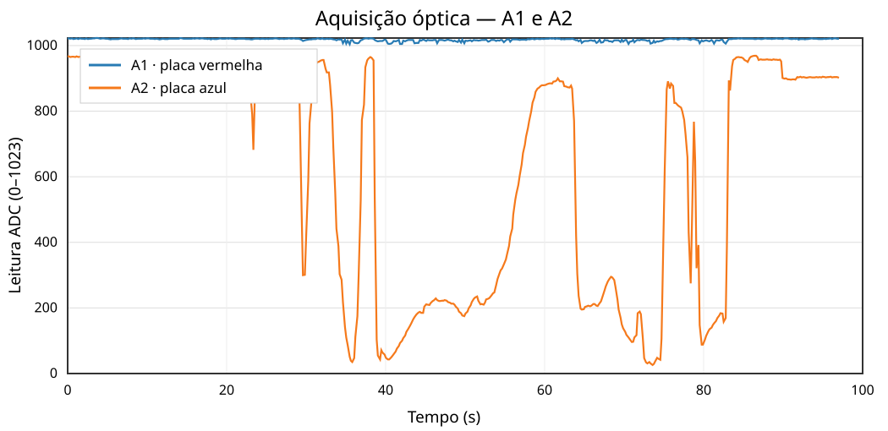

# Optical acquisition — 17 October 2026

## Objective
Recover and characterize the PASCO/FlexDuino optical acquisition subsystem, then record measurements in the PASCO Studio desktop application.

## Hardware and acquisition setup
The optical module was connected through the FlexDuino **ANALOG DB15** connector.

| DB15 pin | Arduino pin | Function |
| --- | --- | --- |
| 2 | A1 | Red optical board analog output |
| 3 | A2 | Blue optical board analog output |
| 9 | 5V | Power |
| 15 | GND | Ground |

The [optical diagnostic firmware](../../../firmware/diagnostics/optical_a1_a2/optical_a1_a2.ino) sends `A1=...;A2=...` at **9600 baud**, approximately every 200 ms.

## Tests performed
- Response to room lighting and darkness.
- Response to a mobile phone flashlight at varying distances.
- Preliminary angular response to flashlight incidence.
- Real-time serial acquisition and plotting with PASCO Studio V0.1.
- CSV and PNG export from the desktop application.

These tests were preliminary. No calibrated reference lux meter was used.

## Observations
**A2 (blue board)** exhibited a strong, repeatable response to changes in illumination. In the tested setup, stronger direct light generally corresponded to *lower* ADC values. During the documented time series, A2 ranged from **26 to 969 ADC counts**.

**A1 (red board)** remained near the top of the ADC range (**1004–1023 counts** in the recorded time series), with no reliably identified light response. The cause has **not** been established, so A1 is **not validated**.

The recorded acquisition contains **485 measurements over 97.02 seconds**.

> ADC counts are raw digitized readings, not measurements in lux. No optical calibration has been established.

## Data and report
The two original CSV acquisitions, a reproducible SVG visualization generated from the first CSV, and the Technical Report 10 LaTeX source are published here. The original PNG and the compiled PDF are still pending binary upload.

- [First acquisition CSV](data/pasco_optica_20261017_193929.csv)
- [Second acquisition CSV](data/pasco_optica_20261017_194004.csv)
- [Optical acquisition chart (SVG)](figures/aquisicao_optica.svg)
- [Technical Report 09 (ultrasonics, PDF)](../../../docs/relatorios/Relatorio_09_Validacao_Comparativa_do_Sistema_Ultrassonico.pdf)
- [Technical Report 10 (LaTeX source)](../../../docs/relatorios/relatorio_10_pasco_optica.tex)
- [PASCO Studio V0.1 (Python)](../../../software/acquisition/pasco_studio_v01.py)

## Next steps
1. Diagnose the A1 channel (wiring, power, sensor output, ADC saturation).
2. Confirm A2 remains stable after power cycling without moving the enclosure.
3. Perform controlled and annotated light/dark acquisitions.
4. Evaluate calibration using a reference light-measuring instrument.
5. Validate the temperature module within PASCO Studio before unifying sensor firmware.

**Status:** A2 functional for preliminary acquisition; A1 unvalidated; calibration and power-cycle stability checks pending.
